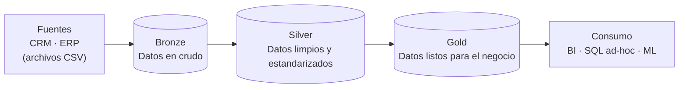

# Proyecto de Data Warehouse

¡Bienvenido al repositorio del **Proyecto de Data Warehouse**! 🚀
Este proyecto muestra cómo construir un data warehouse moderno con SQL Server, desde archivos CSV en crudo hasta un esquema estrella listo para el negocio, siguiendo buenas prácticas de ingeniería y modelado de datos.

---

## 🏗️ Arquitectura de datos

La arquitectura de datos sigue la **Arquitectura Medallion** con las capas **Bronze**, **Silver** y **Gold** (ver [docs/diagrams.md](docs/diagrams.md)):



1. **Capa Bronze**: guarda los datos en crudo, tal como vienen de los sistemas fuente. Los datos se cargan desde archivos CSV a tablas de SQL Server (carga completa, truncate & insert).
2. **Capa Silver**: limpieza, estandarización y normalización de los datos para prepararlos para el análisis.
3. **Capa Gold**: datos listos para el negocio, modelados en un esquema estrella (vistas) para reportes y análisis.

---

## 📖 Descripción del proyecto

Este proyecto incluye:

1. **Arquitectura de datos**: diseño de un data warehouse moderno usando la Arquitectura Medallion.
2. **Pipelines ETL**: extracción, transformación y carga de los datos desde los sistemas fuente al warehouse.
3. **Modelado de datos**: desarrollo de tablas de hechos y dimensiones optimizadas para consultas analíticas.

Decisiones de ETL: pull · extracción completa · lectura de archivos (file parsing) · procesamiento por lotes (batch) · carga completa (truncate & insert) · SCD 1.

---

## 🚀 Requisitos del proyecto

### Construcción del data warehouse (ingeniería de datos)

#### Objetivo

Desarrollar un data warehouse moderno con SQL Server para consolidar los datos de ventas, permitiendo reportes analíticos y una toma de decisiones informada.

#### Especificaciones

- **Fuentes de datos**: importar datos de dos sistemas fuente (ERP y CRM) entregados como archivos CSV.
- **Calidad de datos**: limpiar y resolver los problemas de calidad de datos antes del análisis.
- **Integración**: combinar ambas fuentes en un único modelo de datos, fácil de usar y diseñado para consultas analíticas.
- **Alcance**: trabajar solo con el conjunto de datos más reciente; no se requiere historización.
- **Documentación**: documentar claramente el modelo de datos para apoyar tanto a los usuarios de negocio como a los equipos de análisis.

---

## 📂 Estructura del repositorio

```
sql-data-warehouse-project/
│
├── datasets/                           # Datos en crudo usados en el proyecto (datos del ERP y del CRM)
│   ├── source_crm/                     # cust_info.csv, prd_info.csv, sales_details.csv
│   └── source_erp/                     # CUST_AZ12.csv, LOC_A101.csv, PX_CAT_G1V2.csv
│
├── docs/                               # Documentación del proyecto
│   ├── data_catalog.md                 # Catálogo de la capa gold: tablas, columnas y descripciones
│   ├── diagrams.md                     # Arquitectura, flujo de datos, integración y modelo de datos
│   └── naming_conventions.md           # Reglas de nombres para tablas, columnas y archivos
│
├── scripts/                            # Scripts SQL de ETL y transformaciones
│   ├── init_database.sql               # Crea la base de datos DataWarehouse y sus esquemas
│   ├── bronze/                         # DDL y procedimiento de carga de la capa bronze
│   ├── silver/                         # DDL y procedimiento de carga de la capa silver
│   └── gold/                           # Vistas de la capa gold (esquema estrella)
│
├── tests/                              # Pruebas de calidad de datos para silver y gold
│
├── README.md
├── LICENSE
└── .gitignore
```

---

## ▶️ Cómo ejecutarlo

La carga de bronze lee los archivos CSV desde `C:\sql\dwh_project\datasets\`. En Windows, copia ahí la carpeta `datasets`. En macOS o Linux, ejecuta SQL Server en Docker con la carpeta montada (SQL Server en Linux interpreta `C:\` como `/`):

```bash
docker run -d --name sql-dwh --platform linux/amd64 \
  -e ACCEPT_EULA=Y -e 'MSSQL_SA_PASSWORD=SqlServer!2026' -p 1433:1433 \
  -v "$PWD/datasets:/sql/dwh_project/datasets:ro" \
  mcr.microsoft.com/mssql/server:2022-latest
```

Conéctate (SSMS, Azure Data Studio o VS Code: servidor `localhost`, usuario `sa`) y ejecuta en este orden:

1. `scripts/init_database.sql`
2. `scripts/bronze/ddl_bronze.sql`, `scripts/bronze/proc_load_bronze.sql` y luego `EXEC bronze.load_bronze;`
3. `scripts/silver/ddl_silver.sql`, `scripts/silver/proc_load_silver.sql` y luego `EXEC silver.load_silver;`
4. `scripts/gold/ddl_gold.sql`
5. `tests/quality_checks_silver.sql` y `tests/quality_checks_gold.sql`

---


